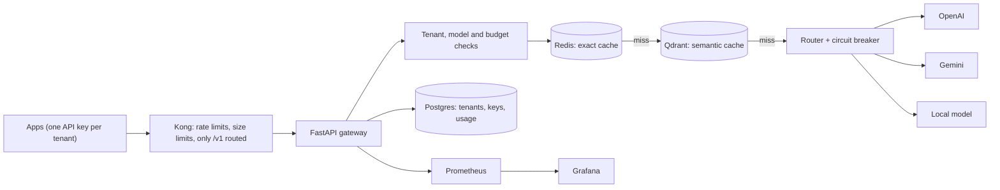

# Dwarpal

A multi-tenant LLM gateway with hybrid semantic caching, built and benchmarked for Bangla,
English and Banglish queries.

Product teams that call OpenAI, Gemini or Claude directly end up with scattered API keys, no
per-team cost visibility, repeated payment for identical questions, and outages that take the
app down. Dwarpal is one OpenAI-compatible endpoint in front of all providers that fixes those.

## Architecture



## Results

All numbers come from `bench/results/` and are reproducible with the commands in
[docs/benchmark-report.md](docs/benchmark-report.md).

| What | Result |
|---|---|
| Best embedding model on my Bangla/Banglish pairs | <<MEASURED: model, threshold, hit rate at zero wrong hits>> |
| Cache HIT vs MISS latency (p50) | <<MEASURED: HIT ms vs MISS ms>> |
| Time to first token, cached vs uncached | <<MEASURED: ms vs ms>> |
| Outage drill: requests answered while the primary was down | <<MEASURED: x of y>> |
| Calls that reached the failing provider | <<MEASURED: n of y>> |

Load tests use a mock provider with an artificial delay: they measure the gateway and cache,
not LLM quality. The labeled pair set is <<MEASURED: N pairs>>, which is small.

## Quickstart

```bash
git clone <this repo> && cd dwarpal
cp .env.example .env        # set DWARPAL_ADMIN_KEY, then your provider keys
docker compose up -d --build
```

Create a tenant (admin API, localhost-only port) and call the gateway:

```bash
curl -s -X POST localhost:8001/admin/tenants -H "Authorization: Bearer $ADMIN_KEY" \
  -H "Content-Type: application/json" -d '{"id":"demo-app","name":"Demo"}'
curl -s -X POST localhost:8001/admin/tenants/demo-app/keys -H "Authorization: Bearer $ADMIN_KEY"
```

```python
from openai import OpenAI
client = OpenAI(base_url="http://localhost:8000/v1", api_key="dk_live_...")
client.chat.completions.create(model="auto", messages=[{"role": "user", "content": "hi"}])
```

Only the two lines `base_url` and `api_key` change in an existing OpenAI client.

### Console (local testing UI)

Set `DWARPAL_CONSOLE_ENABLED=true` and open `http://localhost:8001/console`. Sign in with your
`DWARPAL_ADMIN_KEY`. The console manages tenants and keys, chats as any tenant, shows traffic and
health, and runs a self-test. It is served on the direct gateway port only and must never be
exposed publicly.

## Features

- OpenAI-compatible `/v1/chat/completions`, with SSE streaming
- Tenants with hashed API keys, instant revoke, rotation with an overlap window
- Per-tenant model allow-list, cache opt-out, semantic threshold, fallback on/off, kill switch
- Monthly token and cost budgets (429), price table, cost metrics
- Two cache layers: Redis exact match, Qdrant semantic match; never caches personal data or
  time-sensitive questions
- Fallback chains with a circuit breaker; streams fall back only before the first token
- JSON logs with request IDs, Prometheus metrics, Grafana dashboard, alert rules
- Alembic migrations, Docker Compose, CI

## Security model

- API keys are stored as SHA-256 hashes and shown once. Admin API uses a separate key and is not
  routed by Kong. `/docs`, `/openapi.json` and `/metrics` are not exposed at the edge.
- Redis, Qdrant and Postgres are on the internal network only.
- Cache entries are scoped by tenant, model and system prompt, and a test proves isolation.
- Logs never contain prompts, answers, keys or query strings. Provider errors are never shown to clients.
- The playground is off by default and keeps keys in page memory only.

## Decisions and limits

See [docs/decisions.md](docs/decisions.md) and [docs/runbook.md](docs/runbook.md). Known limits:
streamed token counts are estimates, circuit state is per process, there is no cache purge
endpoint yet, and provider timeouts are fixed at 60 s.

## Development

```bash
pip install -r requirements-dev.txt
make test && make lint
```
